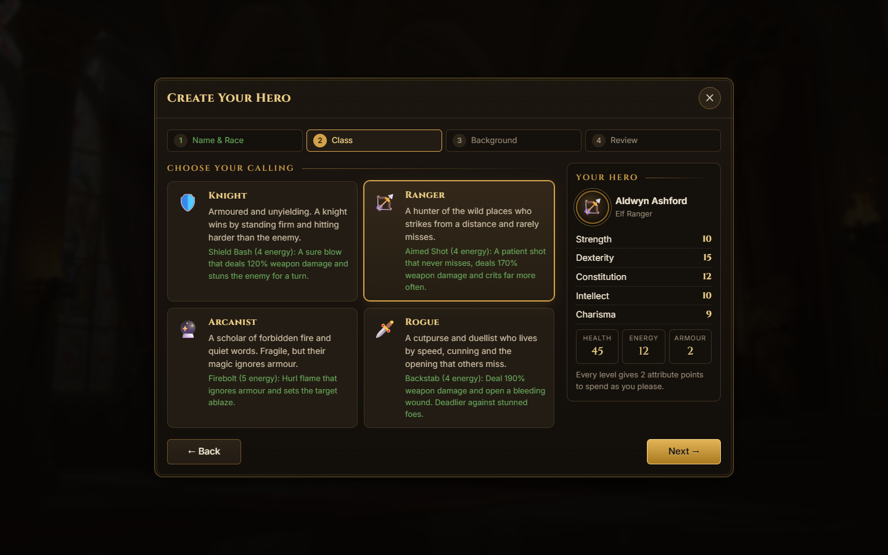
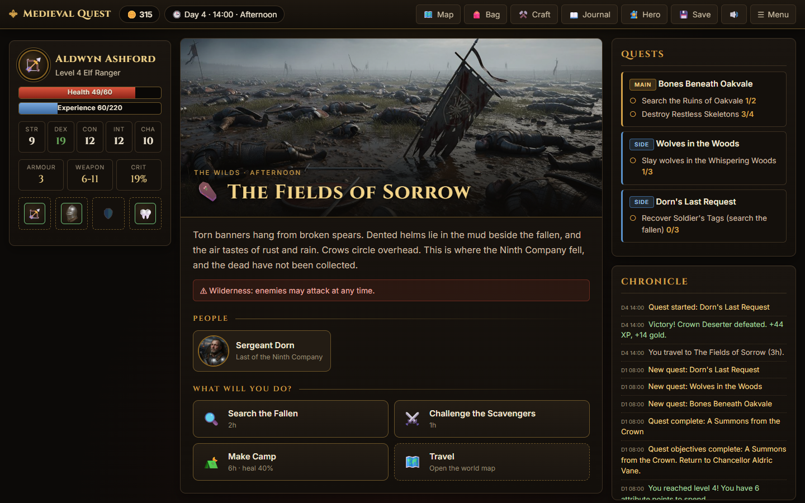
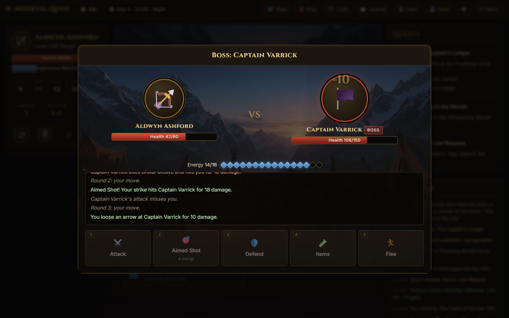
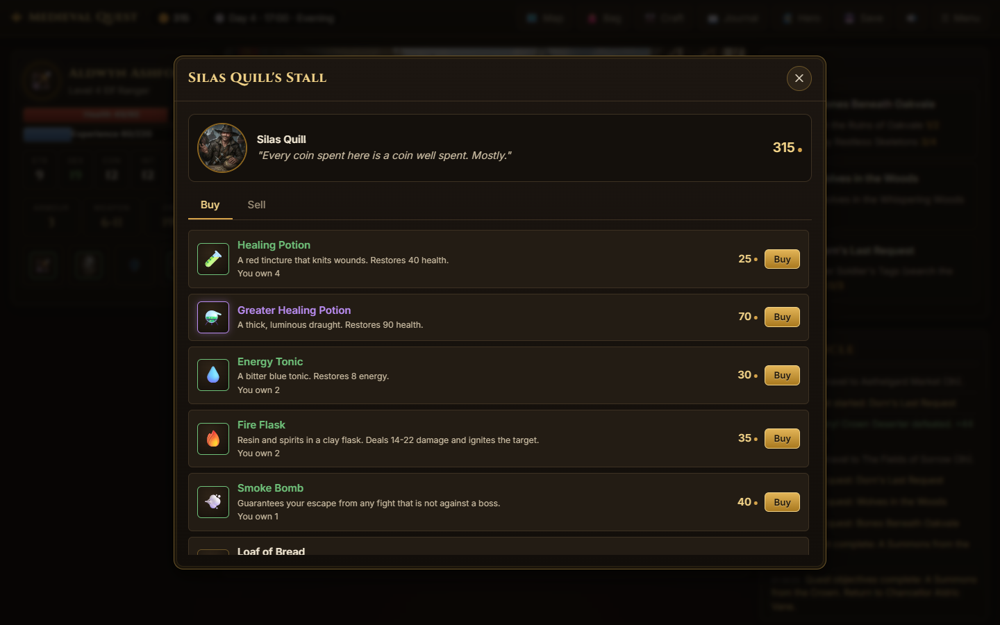

# Medieval Quest

A browser role-playing game set in the kingdom of Aethelgard: create a hero, take quests, fight turn-based battles, trade with merchants, craft gear and decide the fate of a cursed seal. It is written in plain HTML, CSS and JavaScript with no frameworks, no dependencies and no build step.


**[Play it in the browser](https://vaas125.github.io/medieval-quest-rpg/)**

| Character creation | Exploring |
| --- | --- |
|  |  |
| **Turn-based combat** | **Merchants** |
|  |  |

## What is in the game

- **Character creation** in four steps: 4 races, 4 classes and 4 backgrounds (64 combinations). Each changes your attributes, starting gear, gold and traits, and every class has its own combat ability.
- **A main story and side quests**: 11 quests (5 main, 6 side) with kill, collect, craft, explore and talk objectives, branching turn-ins and 4 different endings. Your choices change your standing with three factions.
- **Turn-based combat** against 12 enemy types and 2 bosses. Attack, use a class ability (costs energy), defend, use items or flee. Bleeding, poison, burning and stun effects, critical hits, enraged bosses, floating damage numbers and a combat log.
- **Eight locations** across the capital and the wilds, a world map, a day and night cycle, 34 exploration events (some with choices and skill checks), ambushes, foraging and camping.
- **Economy and crafting**: four shops with buy and sell, prices that react to your charisma and reputation, 47 items (weapons, armour, trinkets, consumables, materials, trade goods) and 8 crafting recipes at the forge and alchemy tables.
- **Progression**: 10 levels, attribute points to spend, equipment requirements, and 8 achievements.
- **Saving**: autosave plus three manual save slots in the browser's local storage, and persistent settings (volume, difficulty, autosave, reduced motion).
- **Audio** generated live with the Web Audio API (ambient music and sound effects, no audio files).
- **Accessible and responsive**: keyboard shortcuts (`M` map, `I` inventory, `C` character, `J` journal, `K` crafting, `S` save, `1`-`5` in combat), focus-trapped dialogs, ARIA labels and live regions, reduced-motion support, and a layout that adapts from desktop to phone.

## Run locally

No build is required. The game is static, so any web server works:

```bash
npx serve .
# or
python -m http.server 8000
```

Then open the printed address. Opening `index.html` directly from the file system also works.

## Project structure

```
index.html     Landing page
game.html      The game (title screen, game screen and dialog containers)
landing.js     Ember particle effect for the landing page
gamedata.js    All content: races, classes, backgrounds, items, enemies, locations, NPCs, shops, quests, recipes
system.js      Game rules with no DOM access: combat, quests, economy, crafting, world and time, saving
ui.js          Modal manager, toasts and the HTML builders for every screen
main.js        Controller: title screen, character creation, dialogue, shops, events and the combat screen
audio.js       Procedural sound effects and music
style.css      Styles for the whole project
fonts/         Self-hosted Cinzel and Inter (latin subset)
images/        Scenes, portraits and item art (compressed JPEG)
docs/          Screenshots used in this README
```

The rules in `system.js` never touch the page; they publish events on a small bus (`Bus`) and the UI listens to them.

## Notes

- All progress is stored in your browser's local storage. Use Settings, then "Erase all saves and settings" to reset everything.
- Scene, portrait and item art are included in the repository.

## License

[MIT](LICENSE)
