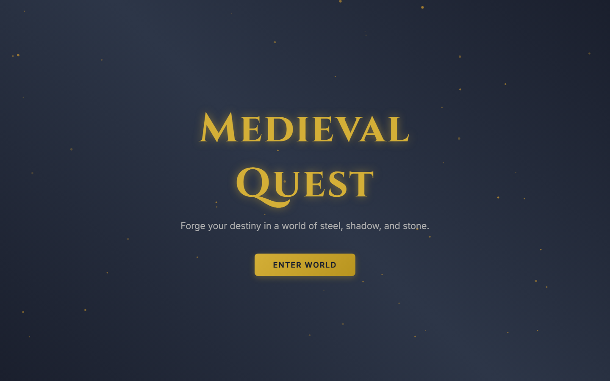

# Medieval Quest

A browser-based medieval role-playing game with character creation, quests, turn-based combat, a merchant economy and a persistent save system. It is written in plain JavaScript with no frameworks or build step.



**[Play it in the browser](https://vaas125.github.io/medieval-quest-rpg/)**

## Features

- **Character creation**: choose a race, class and background; each changes your stats, skills, starting equipment and gold
- **Quest system** with objectives, rewards and a quest journal
- **Turn-based combat** with floating damage numbers and a combat log; weather (for example rain) changes the odds
- **Economy**: merchants where you buy and sell items; prices move with supply and demand
- **Dynamic world**: locations, factions, in-game time, changing weather and random events
- **Relationships and AI**: NPC relationship tracking and an AI system for non-player characters
- **Crafting recipes and inventory** management
- **Save and load** with auto-save and a saved-games menu
- **Audio and particle effects** on the landing page

## How the code is organised

The game logic is split into systems, each a class in [`system.js`](system.js):

| System | Responsibility |
| --- | --- |
| `QuestSystem` | Quest state, objectives, rewards |
| `AdvancedCharacterSystem` | Stats, skills and equipment |
| `EconomySystem` | Supply and demand pricing, buying and selling |
| `AdvancedCombatSystem` | Combat rules, weather effects and resolution |
| `DynamicWorldSystem` | Time, weather and random events |
| `AdvancedAISystem` | NPC behaviour |
| `RelationshipSystem` | Faction and NPC relationships |

```
index.html     Landing page
game.html      The game itself
main.js        Game loop, UI updates, combat and shop flow
system.js      The game systems listed above
gamedata.js    Races, classes, backgrounds, locations, factions, quests, items, recipes
audio.js       Sound handling
style.css      Styling
images/        Scenes, portraits and item art
```

## Run locally

No build is required. Open `index.html` in a browser, or serve the folder:

```bash
npx serve .
```

## Notes

The in-game text is in Turkish.

## License

[MIT](LICENSE) © Arif Enes
